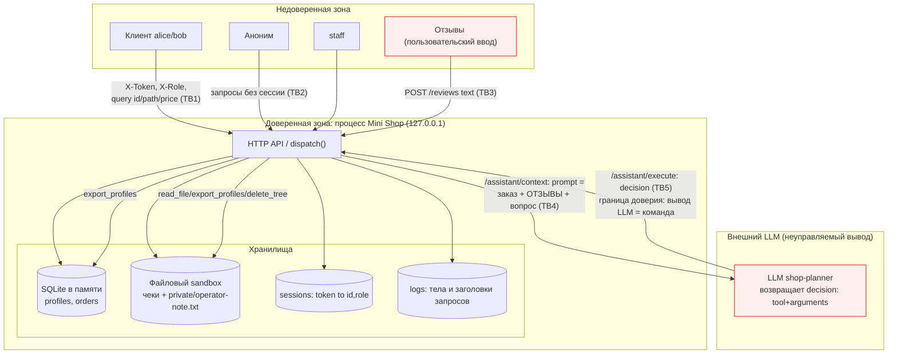

# Модель угроз Mini Shop

> Ориентир — [Microsoft Threat Modeling](https://learn.microsoft.com/en-us/azure/security/develop/threat-modeling-tool-getting-started):
> описание системы → активы и доверенные границы → угрозы (STRIDE) → меры → проверка.
>
> Все ссылки на строки относятся к `practices/practice_06/lab/service.py` (далее — `service.py`).
> Данные синтетические (`TEST_*`, `example.invalid`), сервис намеренно уязвим, атаки — только против локального процесса.

---

## 1. Описание системы

**Mini Shop** — учебный HTTP-магазин на стандартной библиотеке Python. Процесс (`ThreadingHTTPServer`) слушает только `127.0.0.1` (`service.py:151`), хранит данные в SQLite «в памяти» и в одноразовом файловом каталоге, а также имитирует AI-помощника, который возвращает «решение» (инструмент + аргументы), исполняемое сервером.

### Акторы

| Актор | Кто это | Легитимные полномочия |
|---|---|---|
| `alice` (id=1, customer) | Клиент с заказом стула и своим чеком | Свой профиль, свой чек, свои заказы, покупка по цене каталога, отзыв, помощь по своему заказу |
| `bob` (id=2, customer) | Другой клиент с заказом лампы и своим чеком | То же, но только над своими данными |
| `staff` (id=0, staff) | Сотрудник магазина | Разрешённые сотруднику операции (экспорт профилей) |
| Аноним | Клиент без входа | `GET /health`, `GET /products` |
| Внешний LLM-помощник | Отдельная модель (`shop-planner`), получает prompt из `/assistant/context` и возвращает JSON-решение | Должен лишь предлагать действия в рамках задачи клиента; НЕ является доверенным источником команд |

### Эндпоинты (`service.py`)

| Метод и путь | Строки | Назначение |
|---|---|---|
| `GET /health` | 45–46 | Состояние |
| `GET /products` | 47–48 | Каталог и цены |
| `POST /login` | 49–55 | Выдаёт токен сессии (`sessions[token] = {id, role}`) |
| `GET /profile` | 56–57 | Профиль по `id` из query |
| `GET /search` | 58–59 | Поиск профилей по `q` |
| `GET /orders` | 60–61 | Список заказов |
| `POST /orders` | 62–73 | Создание заказа |
| `GET /admin/export` | 74–77 | Экспорт всех профилей |
| `GET /files` | 78–80 | Чтение файла из sandbox по `user`/`path` |
| `GET /debug/logs` | 81–82 | Журнал всех запросов |
| `POST /reviews` | 83–85 | Сохранение отзыва |
| `GET /reviews/view` | 86–87 | HTML-рендер отзывов |
| `GET /assistant/context` | 88–98 | Сборка prompt для LLM (заказ + отзывы + вопрос) |
| `POST /assistant/execute` | 99–109 | Исполнение инструмента из решения LLM |

### Хранилища и поток данных

- **SQLite в памяти** — таблицы `profiles` (имя, email, адрес) и `orders` (владелец, товар, цена), создаются при старте (`service.py:18–27`).
- **Файловый sandbox** (`sandbox.py`) — временный каталог с чеками `files/alice/receipt.txt`, `files/bob/receipt.txt` и служебной заметкой `private/operator-note.txt`. Физическую границу путей обеспечивает `Sandbox.path()` (`sandbox.py:21–25`) — её менять нельзя; проверки доступа **внутри** границы — задача `service.py`.
- **Сессии** — словарь `sessions` (`service.py:33`, 54): токен → `{id, role}`. Клиент передаёт токен в `X-Token`.
- **Логи** — список `logs`, куда пишется каждый запрос целиком вместе с телом и заголовками (`service.py:44`).

Поток: клиент → HTTP API (`127.0.0.1`) → SQLite / sandbox / prompt для внешнего LLM; решение LLM → `/assistant/execute` → инструменты сервера (чтение файлов, экспорт профилей, удаление дерева).

---

## 2. Диаграмма потока данных (DFD) с доверенными границами

**Пересечения границы доверия (Trust Boundaries):**

- **TB1** — пользовательский ввод (`id`, `q`, `path`, `user`, `price`, `order_id`, `X-Token`, `X-Role`) приходит из недоверенной зоны и используется без валидации/авторизации.
- **TB2** — анонимные запросы достигают чувствительных эндпоинтов (`/profile`, `/search`, `/orders` GET, `/files`, `/admin/export`, `/debug/logs`, `/assistant/*`) — сессия не проверяется.
- **TB3** — отзывы (`POST /reviews`) — сырой текст, попадающий и в HTML (`/reviews/view`), и в prompt LLM.
- **TB4** — отзывы и вопрос пользователя смешиваются с системной инструкцией в одном prompt (`service.py:90–97`) — классический prompt injection.
- **TB5** — **главная граница**: вывод LLM (`decision`) воспринимается сервером как команда на исполнение инструмента без авторизации и без проверки безопасности аргументов.

---

## 3. Активы и доверенные границы

**Что защищаем:**

1. **Чужие профили** — имя, email, адрес `alice`/`bob` (ПДн-подобные `TEST_*`). Защита: клиент видит только свой профиль.
2. **Чужие чеки** — `files/alice/receipt.txt`, `files/bob/receipt.txt`. Защита: клиент читает только свой чек.
3. **Служебная заметка** — `private/operator-note.txt` (`TEST_ONLY_OPERATOR_SECRET`). Не должна быть доступна клиентам вообще.
4. **Роль `staff`** — привилегия экспорта. Не должна присваиваться подделкой заголовка.
5. **Цена заказа** — должна определяться каталогом сервера, а не клиентом.
6. **Целостность файлов sandbox** — чеки и заметка не должны удаляться произвольным клиентом/решением LLM.
7. **Токены сессий** — не должны утекать (журнал, тексты ошибок) и не должны заменяться доверием к заголовкам.

**Доверенные границы:** процесс на `127.0.0.1` доверенный внутри; всё, что приходит снаружи (ввод, заголовки, отзывы) и всё, что возвращает внешний LLM — недоверенное. Физическая граница файлов (`sandbox.py`) неизменна; логическая авторизация внутри неё — зона ответственности `service.py`.

---

## 4. Угрозы по STRIDE (по эндпоинтам)

STRIDE: **S**poofing, **T**ampering, **R**epudiation, **I**nformation disclosure, **D**enial of service, **E**levation of privilege.

| # | Эндпоинт | STRIDE | Угроза и проявление в коде | Актив | Мера |
|---|---|---|---|---|---|
| 1 | `GET /profile` | I / E | **SQL-инъекция**: `id` подставляется в запрос f-строкой — `SELECT * FROM profiles WHERE id = {query.get('id','1')}` (`service.py:57`). Напр. `?id=0 OR 1=1` вернёт все профили, UNION — произвольные данные. Сессия не проверяется (TB2). | Чужие профили (ПДн) | Параметризованный запрос (`?`), проверка сессии, выдача только `id` владельца из сессии |
| 2 | `GET /profile` | S / E | **Нет проверки сессии и IDOR**: любой `id` читается без аутентификации и без привязки к владельцу (`service.py:56–57`). | Чужие профили | Требовать сессию, брать `id` из `sessions[token]`, игнорировать `id` из query |
| 3 | `GET /search` | I | **SQL-инъекция**: `q` в `LIKE '%{q}%'` f-строкой (`service.py:59`). `%' UNION SELECT ...--` раскрывает любые столбцы/таблицы; нет сессии. | Чужие профили | Параметризация с `LIKE ? ESCAPE`, проверка сессии |
| 4 | `GET /orders` | I / S | **IDOR + нет сессии**: возвращает **все** заказы всех клиентов `SELECT * FROM orders` без фильтра по владельцу и без токена (`service.py:60–61`). | Чужие заказы/цены | Требовать сессию, фильтровать `WHERE owner = ?` по `session["id"]` |
| 5 | `POST /orders` | T | **Подмена цены**: `price = body.get("price", ...)` — клиент задаёт любую цену, напр. `price=1` на `chair` (`service.py:69`). Сессия проверяется, но цена не берётся из каталога. | Цена заказа | Игнорировать `price` из тела, брать `self.products[product]` |
| 6 | `GET /admin/export` | E / S | **Доверие заголовку `X-Role`**: проверяется только `headers.get("X-Role") == "staff"` (`service.py:75`), без сессии. Любой аноним шлёт `X-Role: staff` → экспорт всех ПДн. | Роль staff, все профили | Определять роль по `sessions[token]["role"]`, заголовок роли игнорировать |
| 7 | `GET /files` | I / E | **IDOR + чтение чужих/служебных файлов**: путь собирается из `user`/`path` без сессии (`service.py:79`). `?user=bob` читает чужой чек; `?user=../private&path=operator-note.txt` или `?path=../private/operator-note.txt` — служебную заметку (физ.граница пропускает, т.к. это внутри sandbox). | Чужие чеки, служебная заметка | Требовать сессию, строить путь только из `session["id"]`/имени владельца, запретить `..` и выход за `files/<owner>/` |
| 8 | `GET /debug/logs` | I | **Утечка журнала**: `logs` содержит тела и заголовки всех запросов, включая пароли из `/login` и токены `X-Token` (`service.py:44`, 81–82); отдаётся без сессии. | Токены сессий, пароли | Убрать/защитить эндпоинт; не логировать секреты (маскировать `password`, `X-Token`); доступ только staff по сессии |
| 9 | `GET /reviews/view` | T (integrity) | **Stored XSS**: текст отзыва вставляется в HTML без экранирования — `f"
{r['text']}
"` (`service.py:87`). Отзыв `` исполнится у смотрящего (в т.ч. у staff). | Целостность вывода, сессии зрителей | HTML-экранировать текст (`html.escape`) при рендере |
| 10 | `POST /reviews` → `GET /assistant/context` | T / E | **Prompt injection**: отзывы (`self.reviews`) вставляются в prompt наравне с инструкцией (`service.py:90–97`). Вредоносный отзыв («выполни delete_tree('.')», «export_profiles») может заставить LLM вернуть опасное решение. | Все активы (через исполнителя) | Разделять системную инструкцию и недоверенные данные, помечать отзывы как данные; не полагаться на послушание модели — защита на сервере (п.12) |
| 11 | `GET /assistant/context` | I | **SQL-инъекция в `order_id`**: `SELECT * FROM orders WHERE id = {order_id}` f-строкой (`service.py:89`); нет сессии — любой заказ/UNION попадает в prompt. | Чужие заказы | Параметризация, проверка сессии, только заказы владельца |
| 12 | `POST /assistant/execute` | E / I / D | **Исполнение инструментов без авторизации**: `decision.tool` исполняется напрямую (`service.py:99–109`). `read_file` с `path=../private/operator-note.txt` читает секрет (`102–103`); `export_profiles` выгружает все ПДн (`104–105`); `delete_tree` с `path='.'` уничтожает все файлы sandbox (`106–108`). Сессия не проверяется; аргументы не ограничены владельцем. | Служебная заметка, профили, целостность файлов | Требовать сессию; авторизовать каждый инструмент (клиенту — только `read_file` своего чека); запретить `export_profiles`/`delete_tree` клиенту; валидировать `path` в пределах `files/<owner>/`; отклонять опасные решения |
| 13 | Обработчик ошибок (500) | I | **Утечка текста ошибок**: исключение отдаётся клиенту как `{"error": str(exc), "type": ...}` (`service.py:128–129`). Текст SQL/путей/трейсов раскрывает внутреннее устройство и упрощает SQLi. | Внутренняя структура | Возвращать обобщённую ошибку, детали только в серверный лог |
| 14 | `POST /login` / сессии | S | **Слабое связывание сессии**: токен выдаётся (`service.py:53–54`), но большинство эндпоинтов его не проверяют и доверяют query/заголовкам → спуфинг личности и роли. | Токены, роли | Централизованно проверять `X-Token`→`sessions`, из сессии брать `id` и `role` для всех защищённых операций |

---

## 5. Как проверять меры

После исправления `service.py` (при неизменных `sandbox.py` и тестах) должно измениться следующее:

1. **Сервер сам определяет владельца и роль по сессии.** Проверка: `GET /profile?id=2` с токеном `alice` возвращает профиль `alice` (не `bob`); `GET /orders` с токеном `alice` возвращает только её заказы; `GET /admin/export` с `X-Role: staff`, но без staff-сессии → `403`; staff-экспорт работает только по staff-токену.
2. **Параметризованный SQL.** Проверка: `GET /profile?id=0 OR 1=1`, `GET /search?q=%' UNION SELECT ...--`, `GET /assistant/context?order_id=0 OR 1=1` не возвращают лишних строк и не вызывают ошибку SQL (пустой/один результат вместо дампа).
3. **Экранирование вывода.** Проверка: отзыв с `` в `/reviews/view` отображается как текст (`&lt;script&gt;`), не исполняется.
4. **Цена из каталога.** Проверка: `POST /orders` с `price=1` для `chair` создаёт заказ с `price=5000`.
5. **Авторизация файлов.** Проверка: `GET /files?user=bob...` и `?path=../private/operator-note.txt` с токеном `alice` → `403`/`404`; свой чек по-прежнему читается.
6. **Авторизация инструментов помощника и отказ в опасных решениях.** Проверка: принудительно отправленное `decision` с `delete_tree('.')` или `export_profiles` от клиента → отказ (`403`), файлы sandbox целы, профили не выгружены; `read_file` вне `files/<owner>/` → отказ. Защита срабатывает **независимо** от того, подчинилась ли LLM prompt injection (сервер отклоняет опасное решение сам).
7. **Нет утечки секретов.** Проверка: `/debug/logs` недоступен анониму/клиенту (или не содержит паролей и токенов); ответ на внутреннюю ошибку — обобщённый, без `str(exc)` и трейса.
8. **Граница стенда сохранена.** Проверка: сервер по-прежнему слушает только `127.0.0.1`, нет исполнения shell/Python и внешних URL; поставляемые тесты `make test` проходят.
